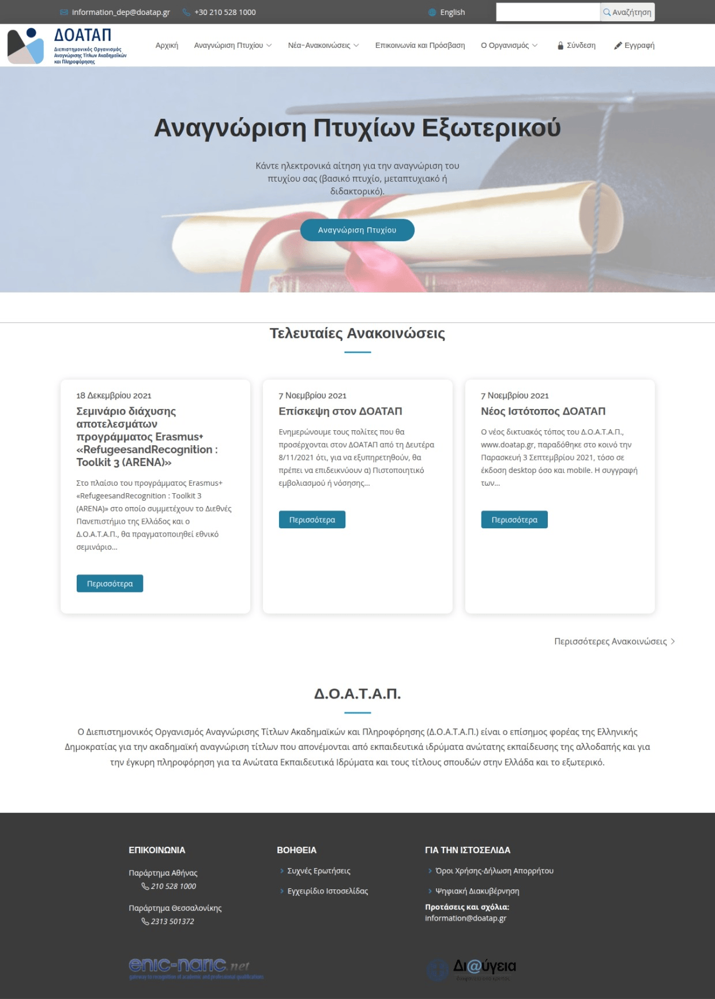
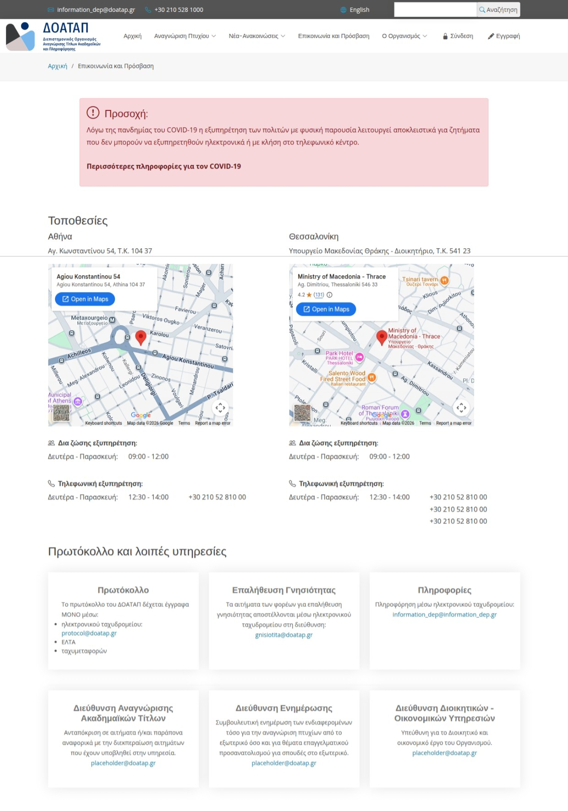
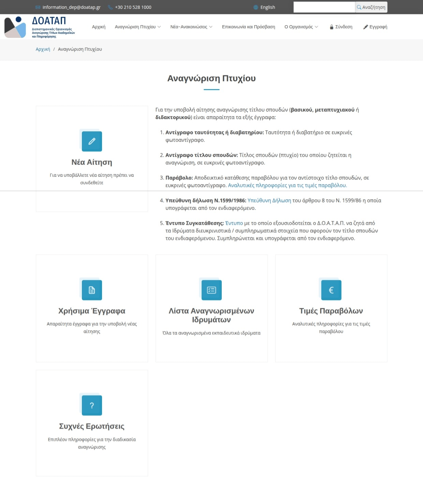
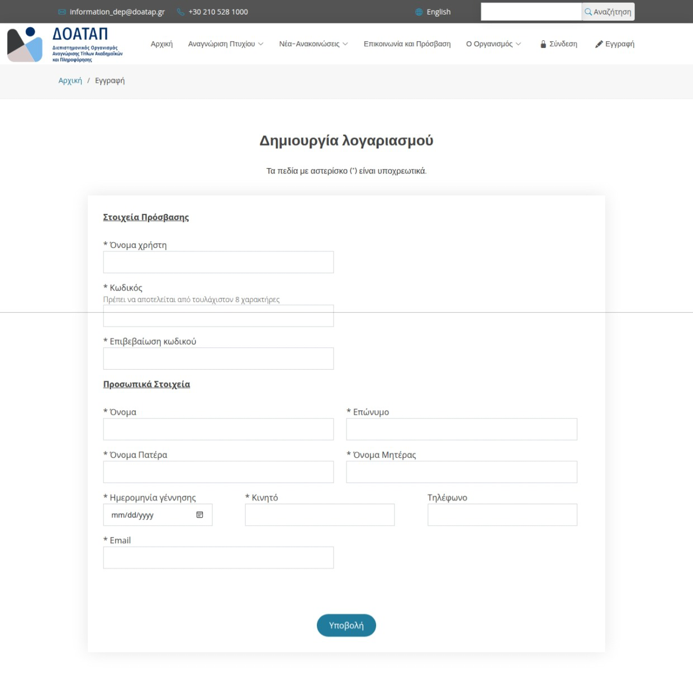
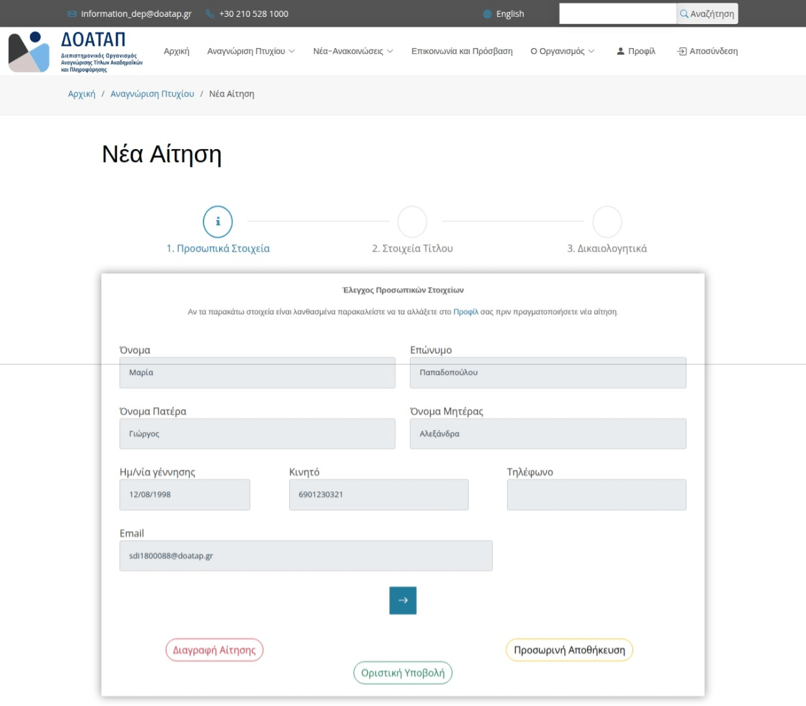
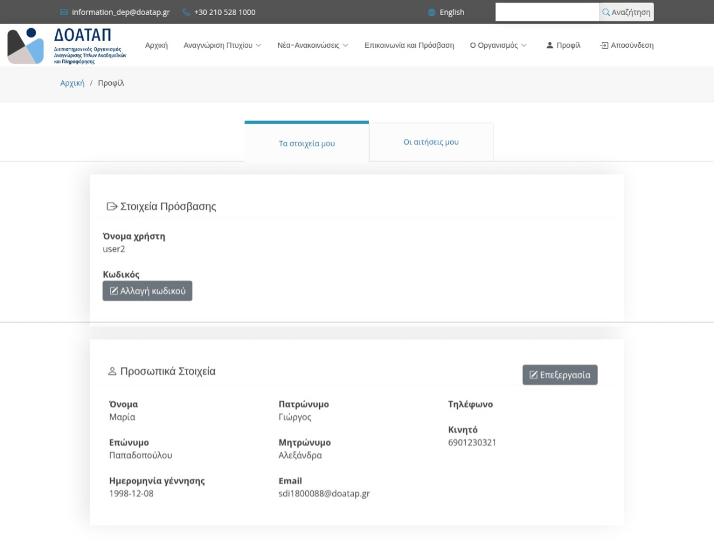
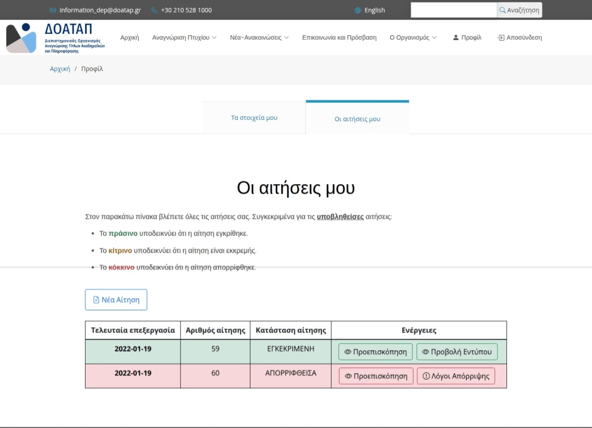
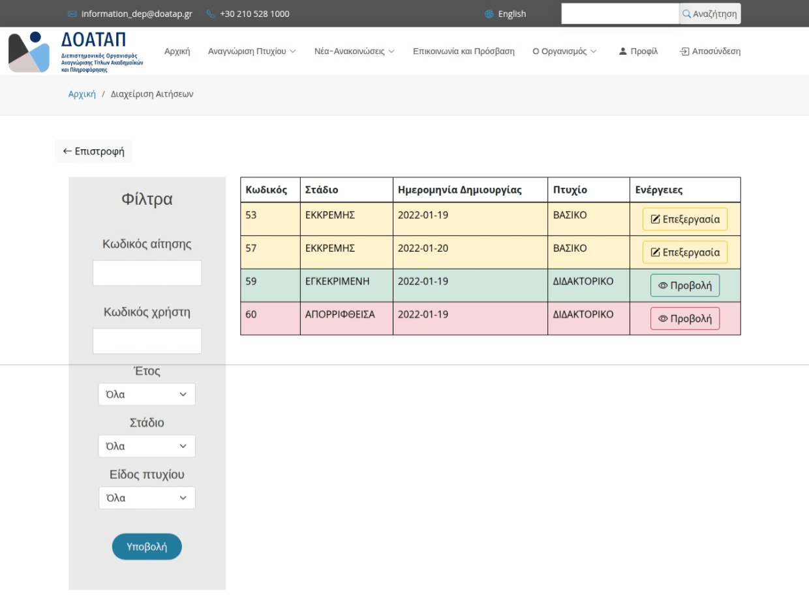

    
     
     
    
        
    
    

---

# Hellenic NARIC (DOATAP) Website Redesign

Redesigned the official website of DOATAP (Hellenic NARIC), focusing on UX Design and user accessibility. Developed as an academic project for the Human-Computer Interaction (HCI) course at NKUA. Made using PHP, SQL, HTML, CSS (Bootstrap) and JAVASCRIPT (Bootstrap, jQuery).

## Requested

* Implement the homepage of the website
* Implement the contact and access information page
* Implement the degree recognition process via an interactive multi-step application form
* Implement the user profile and dashboard for tracking application status (Approved, Pending, Rejected, Draft)
* Implement the administrative dashboard for staff to review, approve/reject applications, and assign required courses

## Stream site

1. Download XAMPP
2. Add this folder to `\xampp\htdocs\` (e.g. `\xampp\htdocs\doatap-redesign`)
3. Open XAMPP Control Panel on your computer
4. Import the database file (`sdi1800073.sql`) in phpMyAdmin under the database name `sdi1800073`
5. Start Apache and MySQL
6. Open in browser `http://localhost/doatap-redesign/`

## Sign in 

* Citizen user: `user2`
* Admin user: `user1`
* Password for all accounts: `12345678`

## Screenshots

### Homepage

### Contact Page

### Degree Recognition Information

### Account Registration

### Multi-Step Application Form 

### Applicant Personal Details

### Application Status Tracking

### Administrative Application Review

## Authors

* **Sergios - Anestis Kefalidis** ([@SKefalidis](https://github.com/SKefalidis))
* **Eleftheria Lagkoni** ([@elagkoni](https://github.com/elagkoni))

